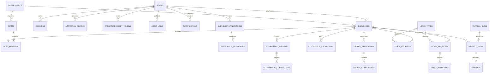

# Database outline

The current implementation uses a private SQLite file. SQL schema changes are applied by numbered migrations in `migrations/`; `schema_migrations` records each applied version. Foreign keys are enabled. Employee IDs and payroll periods have unique constraints. Monetary amounts are represented as integer minor units in the reserved payroll schema, not floating-point amounts.

## Relationships

The diagram includes schema prepared for workflow stages that are not yet exposed by the application. `application_documents` contains private-storage metadata only; the public registration form does not accept documents. Payroll tables do not mean payroll is enabled.

## Tables in the initial schema

- **Identity and onboarding:** `users`, `employees`, `employee_applications`, `application_documents`, `employee_emergency_contacts`, `employee_referrals`, `employee_id_sequences`, `activation_tokens`, `password_reset_tokens`, `sessions`.
- **Organization and access grouping:** `departments`, `teams`, `team_members`. Current application roles are constrained on the user record (`ceo`, `team_lead`, `employee`); public registration cannot choose a role.
- **Attendance:** `attendance_records`, `attendance_exceptions`, `attendance_corrections`, `company_holidays`.
- **Leave:** `leave_types`, `leave_requests`, `leave_approvals`, `leave_balances`.
- **Payroll schema, currently disabled:** `salary_structures`, `salary_components`, `payroll_runs`, `payroll_items`, `payslips`.
- **Operations and controls:** `notifications`, `email_outbox`, `audit_logs`, `company_settings`, `schema_migrations`. The outbox stores recipient and delivery metadata; message bodies are encrypted with the local application key.

Before adopting this schema for existing company records, compare it with the live registration database and create a reviewed, reversible migration plan. Do not copy production identity documents into the development database.
